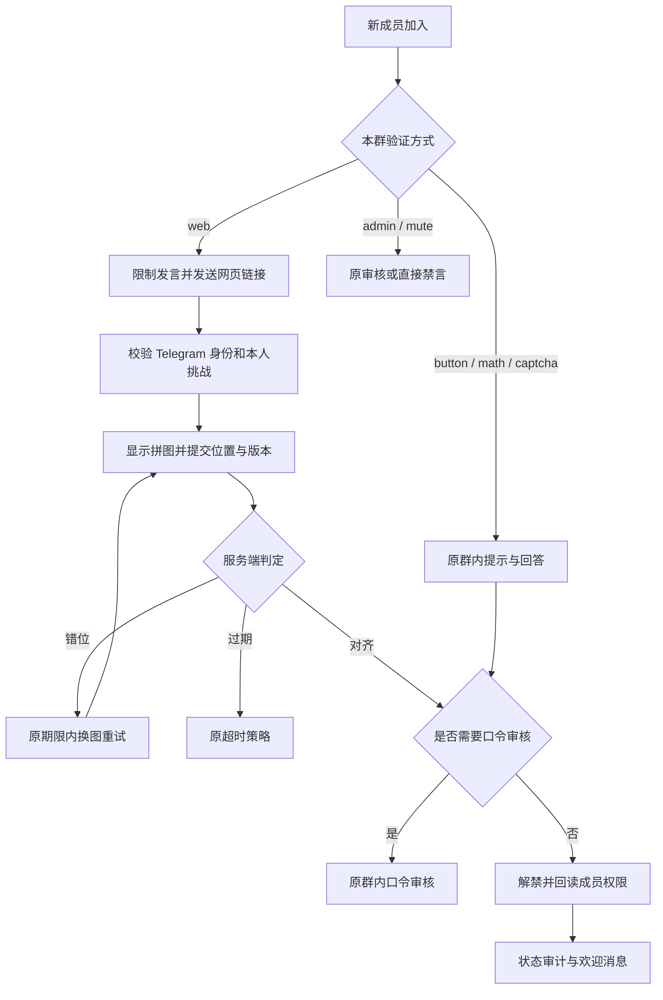

# 群内验证与网页拼图流程

> 日期：2026-11-04（Asia/Shanghai）
> 需求：[入群验证 PRD](../product/2026-11-04-verification-channels-prd.md)

## 最小实现方案

方案一是新增 verification_channel 字段并维护位置与题型的组合；方案二是在现有 verification_mode 增加 web。选择方案二：用户仅需要固定的网页拼图，新增字段会产生多余组合和迁移。现有 button/math/captcha/admin/mute 值不变。

- verification_service 创建群内原题目，或为 web 创建独立随机图片种子及横向答案，复用 challenge.question/answer；不增加数据库字段。
- verification_handler 仅对 web 设置 mini_app_status=pending、限制发言并发送 Mini App 链接。其他类型走原群内提示。
- mini_app_service 仅接收网页拼图的 position 与 puzzle_id；锁定挑战后检查期限、版本及对齐误差。错位重置图片种子和答案，提交新状态后返回可重试错误。
- 服务端 Pillow 将场景和缺口渲染为 PNG，独立裁切透明拼图。图片种子与横向答案留在数据库，API 返回图片和不可反推种子的版本摘要。
- 网页按图片原始宽度换算滑块位置；触摸、鼠标松开时自动提交，键盘 Enter 提交。身份、期限和权限结果以服务端为准。
- 校验成功后继续复用 processing → 解禁/口令审核 → 审计/欢迎链路。保留行锁及先持久化领取再调用 Telegram 的顺序。

## 数据流

## 验证边界

专项测试使用上海隔离 PostgreSQL，Telegram 边界模拟；网页预览使用开发模拟响应。它们验证代码行为，不代表真实 Telegram 成员已完成验证。生产只在完整 CI 通过后发布，不自动发送真实群测试消息。
